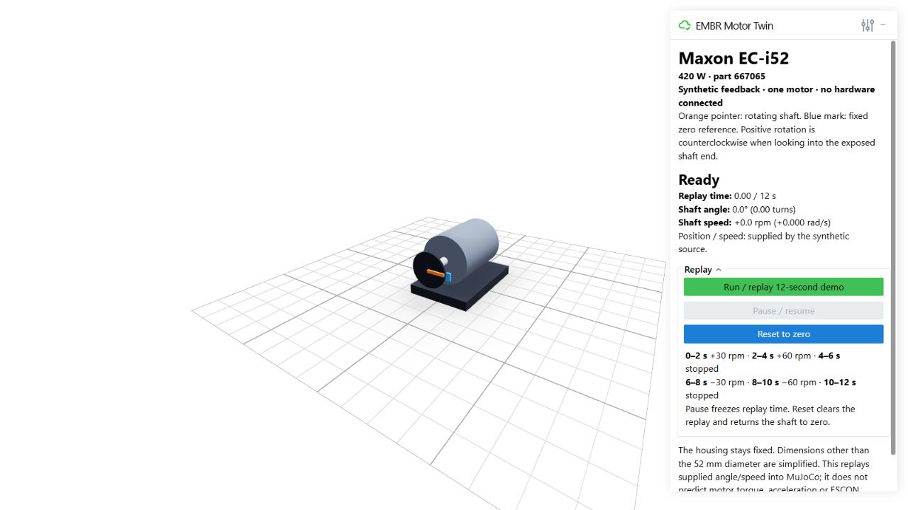

# Maxon EC-i52 motor twin

Task [#73](https://github.com/HEATRobotics/EMBR-AutoBot/issues/73), under
[Component Test Suite #67](https://github.com/HEATRobotics/EMBR-AutoBot/issues/67).
Live ESCON feedback is [#74](https://github.com/HEATRobotics/EMBR-AutoBot/issues/74).
The team handoff is in the **Maxon Motor Twin — Setup and Testing** section of
[Autonomy](https://app.notion.com/p/Autonomy-3fc05a18706d802a85dde3496d757925).

This is one fixed motor housing and one continuous shaft hinge in MuJoCo,
with an orange pointer on the shaft and a fixed blue zero reference. The
browser draws the compiled MuJoCo geometry and its computed transforms.
It is a **telemetry replay twin**: supplied position/speed are applied to
`qpos`/`qvel`, followed by `mj_forward`. It does not use `mj_step` to predict
motion, torque, load, current, drive ramps or ESCON dynamics. An input change
can therefore change speed instantly. Passing the tests validates mapping,
not physical motor accuracy.



## Install and run

Use Python 3.12 or 3.13 and the existing simulation package. From the
repository root, on Windows PowerShell:

```powershell
git switch autonomy/EMBR-73/maxon-motor-twin
cd embr_autonomy/simulation/mujoco
python -m venv .venv
.\.venv\Scripts\python.exe -m pip install -e '.[test]'
.\.venv\Scripts\python.exe -m embr_local_sim motor
```

On macOS/Linux, use `python3.12 -m venv .venv` and substitute
`.venv/bin/python` for `.\.venv\Scripts\python.exe`. No ROS, CAN adapter,
encoder, motor hardware, native OpenGL viewer or new dependency is needed.

Open the printed URL, normally <http://127.0.0.1:43147>. Keep the process
running. If another simulator is using that port, pass `--port 43149`.
Stop the server with Ctrl-C. Closing a tab does not stop the server; multiple
tabs share one replay and its controls. Reloading a tab shows the current
replay state, not a fresh run.

The model starts stationary in **Ready**. Click **Run / replay 12-second demo**.
Each row below lasts two seconds of replay time:

| Replay time | Stage | Speed | Angle at end |
| --- | --- | --- | --- |
| 0–2 s | Forward slow | +30 rpm / +pi rad/s | +360 degrees / 1 turn |
| 2–4 s | Forward fast | +60 rpm / +2pi rad/s | +1080 degrees / 3 turns |
| 4–6 s | Stop | 0 | Holds +1080 degrees |
| 6–8 s | Reverse slow | -30 rpm / -pi rad/s | +720 degrees / 2 turns |
| 8–10 s | Reverse fast | -60 rpm / -2pi rad/s | 0 |
| 10–12 s | Finished / stopped | 0 | Holds 0 |

The low speeds make the pointer visible; they are not motor operating limits.
Pause freezes time and angle, retaining the last sample's speed readout.
Resume continues from that point. Reset stops the replay and clears time,
angle and speed to zero. Replay starts the full sequence again from zero.

The source runs at a nominal 50 Hz and browser updates target 25 Hz. Slow
machines stretch wall-clock playback instead of dropping source samples.
These are software targets, not measured ESCON rates or guaranteed rendering
performance. Camera orbit/zoom remain the normal Viser controls.

## Manual acceptance checks

Only the visual/browser experience requires manual acceptance. Unit tests
already check numerical mapping, directions, fixed housing transforms,
configuration, model export, invalid inputs, estimated angle and replay logs.

| Action | Expected result |
| --- | --- |
| Open the motor URL | One grey fixed housing, silver shaft, black indicator disk, orange moving pointer and blue fixed reference; label says synthetic feedback. Ready reads 0 s, 0 degrees, 0 rpm. |
| Run the demo | Pointer follows the stages above; the housing and mount stay fixed. At 2 s, 60 rpm is twice the earlier 30 rpm; at 4–6 s it is stationary; after 6 s it turns the other way. |
| Pause while rotating | Replay time and pointer freeze. Last observed speed remains displayed. Resume continues without a jump or replaying elapsed wall time. |
| Reset while moving or paused | Ready, 0 s, 0 degrees and 0 rpm; pointer returns to the blue reference. No spontaneous restart. |
| Let the replay finish, then replay | At 12 s it stays at 0 degrees and 0 rpm with pause disabled. Replay starts a new identical sequence. |
| Orbit/zoom during playback | Camera can move independently while the motor stays anchored; readouts and controls remain usable. |

## Source-independent input contract

```python
from embr_local_sim.motor import MotorSample, MotorTwin

twin = MotorTwin()
twin.apply(MotorSample(timestamp_s=0.0, position_rad=0.0, velocity_rad_s=3.141592653589793))
twin.apply(MotorSample(timestamp_s=0.5, position_rad=1.5707963267948966,
                       velocity_rad_s=3.141592653589793))
```

One `MotorTwin` represents one motor. A future adapter routes motor/node IDs
to separate twin instances; there is no hard-coded CAN ID or gearbox ratio.
The API is synchronous and not thread-safe. Call `apply` on one owner thread
or serialize incoming observations through a queue.

| Field or convention | Contract |
| --- | --- |
| `timestamp_s` | Required finite, nonnegative source seconds. Strictly increasing within a stream; first sample can be at zero or a later time. No wall-clock waiting is performed by `apply`. Reset before replaying a stream or changing its time origin. |
| `position_rad` | Optional finite **unwrapped motor-shaft** angle in radians. No automatic modulo, counter unwrapping, homing or gearbox conversion. |
| `velocity_rad_s` | Optional finite motor-shaft angular velocity in radians/second. Value applies from its timestamp until the next observation (zero-order hold for speed-only estimation). |
| Axis/sign | Hinge is world -Y, matching the existing ROS motor URDF axis. Positive is right-hand rotation about -Y: counterclockwise looking into the exposed shaft from the -Y end. The adapter must map actual encoder direction explicitly. |
| Zero | Visual zero places the pointer along +X next to the blue reference. Hardware homing/startup offsets are not inferred. |
| Position and speed supplied | Both map directly to the named hinge. Position takes precedence over any earlier estimate. Input consistency is the source/adapter's responsibility. |
| Position only | Apply position, clear `qvel` to zero and report `velocity_kind="unavailable"`. This is unknown speed, not a measured standstill. No speed is inferred by differencing angles. |
| Speed only | First sample initializes estimated position to visual zero; it does not integrate time before that sample. Later samples integrate the **previous supplied speed** over the interval and report `position_kind="estimated"`. No integration occurs between calls. |
| Speed after position-only | Reject a speed-only update because the preceding interval's speed is unknown. Supply an explicit position with speed to establish a new baseline, or reset the stream. |
| Neither field, nonfinite values, duplicate/backward time | Raise `ValueError` before modifying the previously applied state. |

`MotorState` returns the applied values and `position_kind` (`supplied` or
`estimated`) / `velocity_kind` (`supplied` or `unavailable`). "Supplied" means
present in the input; it does not certify hardware provenance. Demo data is
always labelled synthetic. The hardware adapter in #74 must own stale-data
handling, source status, unit conversion, reference/unwrap and reconnection.

## Parameters and provenance

Defaults are packaged in `bundled/config/maxon_ec_i52.yaml`. Copy that file
and use `motor --config path/to/motor.yaml`; a partial mapping overrides only
specified fields. Unknown fields, malformed YAML, nonnumeric/nonpositive
values, an oversized shaft or invalid rotor inertia fail with a clear error.
Restart the command to load changes.

The [hardware page](https://app.notion.com/p/EMBR-Hardware-Confirmation-40605a18706d80a281acec09def67262)
lists part 667065. The [Maxon catalogue, page 315, March 2025](https://www.maxongroup.com/medias/sys_master/root/9406692622366/Cataloge-Page-EN-315.pdf)
is the source for the diameter, total mass and axial rotor inertia. Verify
the physical motor variant before #74. Existing CAD-exported ROS masses are
not used: they are far below catalogue mass.

| Parameter | Default | Source / limitation |
| --- | --- | --- |
| `housing_radius_m` | 0.026 m | Catalogue diameter 52 mm divided by two. |
| `housing_length_m` | 0.070 m | Assumed simplified envelope; not a CAD or dimensional match. |
| `shaft_radius_m`, `shaft_length_m` | 0.004 m, 0.025 m | Assumed visual shaft. |
| `motor_mass_kg` | 0.752 kg | Catalogue total motor mass; excludes display mount. |
| `rotor_mass_kg` | 0.040 kg | Assumed split of total mass; remaining mass assigned to fixed housing. |
| `rotor_axial_inertia_kg_m2` | 0.000017 kg m^2 | Catalogue 170 g cm^2 multiplied by 1e-7. |
| `rotor_transverse_inertia_kg_m2` | 0.000017 kg m^2 | Assumed admissible transverse inertia. |

The pointer, disk, blue reference and mount are illustrative, noncolliding
display geometry with no added mass. The model has no gravity, contacts,
actuators, electrical model or calibrated dynamics. Mass/inertia are recorded
in the model but do not change imposed telemetry motion.

## Automated verification and portable model

From the package directory:

```powershell
.\.venv\Scripts\python.exe -m pytest tests/test_motor.py
.\.venv\Scripts\python.exe -m embr_local_sim motor --headless --out embr-sim-runs/motor
.\.venv\Scripts\python.exe -m embr_local_sim motor --write-model embr-sim-runs/motor.xml
```

Headless replay needs no browser/Viser import and advances without wall-clock
delays. It prints JSON containing `passed: true`, `samples: 601`,
`duration_s: 12`, final position/speed zero, and mapping errors zero (tolerance
1e-12). `--out` writes `motor_samples.csv` and `motor_summary.json` in the
chosen folder. The test suite separately checks analytical checkpoints and
transformed pointer direction; zero replay errors alone are not a physical
accuracy test. Export writes standalone MJCF with no external assets.

The existing CI runs the new tests as part of the package suite and also
runs the motor headless command. Run evidence and the tested commit are
recorded in issue #73 and its pull request. Generated outputs live under
gitignored `embr-sim-runs/`.
